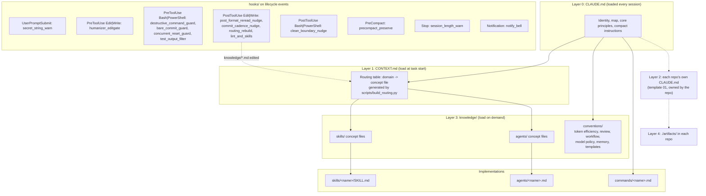

# claude-code-setup

A template for a global Claude Code configuration (`~/.claude`): a layered set of context files, a generated routing table, conventions, a handful of workflow skills, and guard and nudge hooks with a self-test. It is one engineer's working setup, generalized so others can adopt it whole or take pieces.

What you get:

- **Layered context.** A short `CLAUDE.md` map that every session loads, a generated `CONTEXT.md` routing table, and reference knowledge that loads only when a task needs it.
- **Hooks.** Guards that block a few dangerous commands outright, filters that keep test output small, and nudges that catch stale edits, uncommitted work, and long sessions.
- **Validators.** Scripts that keep the routing table, frontmatter, links, and skill index consistent, run in CI.
- **Workflow skills.** Audit waves, converge-until-clean audits, work-package merges, multi-session orchestration prompts, session handoffs, an app kickoff pipeline, vendoring with license gates, runner setup, and a legal-document pass.

## How the layers fit



Why layers: everything in `CLAUDE.md` costs context in every session, so it holds only a map. The routing table tells the model which concept file to open for a task, and the concept file points at the skill or agent that does the work. Reference material stays on disk until a task needs it. Layer 2 (a repository's own `CLAUDE.md`) and layer 4 (working artifacts) belong to each project; [knowledge/conventions/templates/01-claude-md-project-map.md](knowledge/conventions/templates/01-claude-md-project-map.md) is the template for layer 2.

## Repository layout

| Path | What it is |
|------|-----------|
| `CLAUDE.md` | Layer 0 template: identity, map, core principles. Fill in the `<PLACEHOLDERS>` |
| `CONTEXT.md` | Layer 1: routing table between generated markers |
| `_config/preferences.md` | Output detail, response style, writing standard |
| `knowledge/conventions/` | Conventions and templates, linked from `CLAUDE.md` |
| `knowledge/skills/`, `knowledge/agents/` | Concept files that route to skills and agents; `index.md` files are generated |
| `skills/` | Workflow skills (see [Skills](#skills)) |
| `agents/wave-babysitter.md` | Agent that monitors a wave of background subagents |
| `commands/drift-check.md` | `/drift-check`: skill index audit, routing rebuild, hook self-test |
| `hooks/` | Hook scripts, `hookutil.py` (shared helpers), `hooks_selftest.py` |
| `scripts/` | Routing generator and validators; `claude_home.py` holds shared paths and the frontmatter parser |
| `settings.example.json` | Hook wiring and a credential-file deny list to merge into your `settings.json` |

## Hooks

All hooks are standard-library Python 3.10+, read the hook payload as JSON on stdin, and fail open: a crash or malformed payload never blocks your session. Guards block with exit 2 and explain why on stderr.

| Hook | Event | Matcher | Blocks or nudges | Why |
|------|-------|---------|------------------|-----|
| `destructive_command_guard.py` | PreToolUse | `Bash\|PowerShell` | Blocks force-push to main/master, deleting main, pushes to `origin` (policy, configurable), `rm -rf` of a drive root, home, or `.git`, a credential file combined with a network tool, fetch-piped-into-shell installs, deleting `CLAUDE.md`, `settings.json`, `CONTEXT.md`, or `MEMORY.md` | These are the actions where one wrong command loses work or leaks secrets, and where a hook is more reliable than an instruction. Each block except the never-allowed ones has a per-command opt-in prefix that the model adds only after you authorize it |
| `bare_commit_guard.py` | PreToolUse | `Bash\|PowerShell` | Blocks `git commit` with no explicit pathspec (allowed while concluding a merge) | Two sessions in one checkout share one index; a bare commit sweeps up the other session's staged files |
| `concurrent_reset_guard.py` | PreToolUse | `Bash\|PowerShell` | Blocks `git reset` to a ref (`HEAD~1`, a SHA, a branch); allows unstaging | A reset computed against a stale HEAD silently un-commits whatever another session just landed |
| `test_output_filter.py` | PreToolUse | `Bash\|PowerShell` | Rewrites plain test commands (pytest, cargo test, npm test, go test, and others) to pipe through a failures-and-summary filter | Full test logs flood the context; the filter keeps failures and the pass line. Chained commands are left alone, because the rewrite is auto-approved |
| `humanizer_editgate.py` | PreToolUse | `Edit\|Write` | Vetoes writes that add em or en dashes, curly quotes or emoji in code, or a spaced double hyphen used as prose punctuation in comments | Mechanical tells of machine-written text; catching them before the write is cheaper than a pre-commit failure |
| `post_format_reread_nudge.py` | PostToolUse | `Edit\|Write` | Nudges a re-Read when the file on disk no longer matches what was written | A formatter or sync hook rewrote the file; editing from the stale copy fails or reverts the formatter |
| `commit_cadence_nudge.py` | PostToolUse | `Edit\|Write` | Nudges when 5+ files are uncommitted or the last commit is 20+ minutes old (rate limited, tunable) | Finished work sitting uncommitted is the work most likely to be lost or swept into the wrong commit |
| `routing_rebuild.py` | PostToolUse | `Edit\|Write` | Rebuilds `CONTEXT.md` when a `knowledge/*.md` file changes | Keeps the generated routing table from drifting |
| `lint_and_skills.py` | PostToolUse | `Edit\|Write` | Runs ruff or eslint on the edited file; prints skill hints by path (editable table) | Fast lint feedback, and a reminder of the skill that fits the file |
| `clean_boundary_nudge.py` | PostToolUse | `Bash\|PowerShell` | Notes a clean boundary after a validator runs green | A good point to wrap up or start a fresh session |
| `secret_string_warn.py` | UserPromptSubmit | (none) | Warns when a prompt contains a key-shaped string | A pasted credential leaks into the transcript; the model is told not to echo it and to suggest rotation |
| `precompact_preserve.py` | PreCompact | (none) | Adds preservation instructions to compaction | Keeps open todos, plan checkboxes, user decisions, touched paths, and test results through compaction |
| `session_length_warn.py` | Stop | (none) | Warns once when the transcript passes a size threshold (`SESSION_WARN_MB`) | Quality drops as context fills; a fresh session from files is cheaper |
| `notify_bell.py` | Notification | (none) | Terminal bell, plus a system beep on Windows | You hear when Claude needs input |
| `build_noise_filter.py` | not wired | `Glob\|Grep` (when wired) | Strips `node_modules`, `target`, `dist`, and similar from search results | Waiting on Claude Code support for replacing built-in tool output; the logic is tested |
| `mempalace_wakeup.py` | optional | SessionStart | Injects recall context from the third-party MemPalace tool | Only if you use MemPalace; silent when it is not installed |

Opt-in prefixes for `destructive_command_guard.py`: `ALLOW_FORCE_PUSH_MAIN=1`, `SKIP_ORIGIN_PUSH=1`, `ALLOW_CREDENTIAL_ACCESS=1`, `ALLOW_REMOTE_PIPE=1`, `ALLOW_CONFIG_DELETE=1`. The other guards use `AI_ALLOW_BARE_COMMIT=1` and `AI_ALLOW_HEAD_RESET=1`. A prefix is a per-command signal; grant it only for a command you have read.

To wire the optional MemPalace hook, add this group under `"hooks"` in `settings.json`:

```json
"SessionStart": [
  { "hooks": [ { "type": "command", "command": "python3 \"$HOME/.claude/hooks/mempalace_wakeup.py\"", "timeout": 30 } ] }
]
```

## Install

Requirements: Claude Code, Python 3.10 or newer, git. `uv` is optional (the lint hook uses it when present).

1. **Back up** your current `~/.claude` (`cp -r ~/.claude ~/.claude.bak`).

2. **Copy or link the files in.** Copy if you want to edit freely; symlink if you want to pull updates from a clone.

   ```bash
   git clone <this repo> ~/src/claude-code-setup
   cd ~/src/claude-code-setup
   # copy
   cp -r hooks scripts knowledge skills agents commands _config ~/.claude/
   cp -n CLAUDE.md CONTEXT.md ~/.claude/      # -n: do not overwrite yours
   # or symlink the directories instead
   for d in hooks scripts knowledge skills agents commands _config; do ln -s "$PWD/$d" ~/.claude/$d; done
   ```

   Copy the whole `hooks/` directory, not single files: the hooks import `hooks/hookutil.py`, and the scripts import `scripts/claude_home.py`. If you already have skills or agents with the same names, merge by hand.

3. **Merge the hook wiring.** Copy the `hooks` block (and, if you want it, the `permissions.deny` list) from `settings.example.json` into `~/.claude/settings.json`. Do not replace your settings file: it holds your own permissions, model, and plugins.

   Windows: Claude Code runs hook commands through Git Bash, where `$HOME` expands. If `python3` resolves to the Microsoft Store stub, change `python3` to `python` (or `py -3`) in each command. If your hooks run under `cmd.exe` instead, use `%USERPROFILE%` in place of `$HOME`.

4. **Fill in the templates.** Replace the `<PLACEHOLDERS>` in `CLAUDE.md`, `_config/preferences.md`, and `knowledge/conventions/model-policy.md`, then delete the explanatory comments (HTML comments still cost tokens).

5. **Rebuild routing and test the install.**

   ```bash
   cd ~/.claude
   python3 scripts/build_routing.py
   python3 hooks/hooks_selftest.py --installed
   ```

6. **Optional: version your config.** Put `~/.claude` under git and use this repository's `.gitignore`, which keeps credentials, local settings, transcripts, and caches out.

## Customize

- **Origin pushes.** The destructive-command guard blocks session pushes to `origin` by default. To allow them, set `CLAUDE_GUARD_ORIGIN_PUSH=allow` in the `env` block of `settings.json`. Force-push to main stays blocked.
- **Hook tuning.** `COMMIT_CADENCE_FILES`, `COMMIT_CADENCE_MINUTES`, `COMMIT_CADENCE_QUIET`, `COMMIT_CADENCE=0`; `SESSION_WARN_MB` (default 3.8, about 60 percent of a 1M-token window; use 0.75 for 200k); `HUMANIZER_GATE_EXCLUDE` (comma-separated path fragments, for example `i18n/locales/,manuscript/`).
- **Skill hints.** Edit `SKILL_HINTS` in `hooks/lint_and_skills.py` to point at the skills you use.
- **Routing taxonomy.** `DOMAIN_LABELS` in `scripts/build_routing.py` defines the routing sections. Add a domain there, use it in a concept file's `domains`, and rebuild.
- **Adding a skill.** Put it in `skills/<name>/SKILL.md` with `name`, `description` (with a "Use when" clause), and `domains`. Add a row for it to a concept file in `knowledge/skills/` (create one with OKF frontmatter for a new domain; see `knowledge/conventions/okf-spec.md`), then run `scripts/build_routing.py`. `scripts/drift_check.py` reports any installed skill that no concept file mentions; list deliberate exceptions in `knowledge/drift-skip.txt`.
- **Adding a hook.** Write it against `hookutil.py`, wire it in `settings.example.json`, and add behavior cases to `build_cases()` in `hooks/hooks_selftest.py`. The self-test fails on any hook file that is not wired, unless it is listed in `OPTIONAL_HOOKS`.
- **Config root.** Every script resolves its root from `CLAUDE_HOME` when set, else the parent of its own directory, so the same scripts run from a clone, from `~/.claude`, or against any directory you point them at.

## Self-test and validators

From the repository root (or `~/.claude`):

```bash
python3 hooks/hooks_selftest.py              # wiring + behavior cases, using the hooks in this checkout
python3 hooks/hooks_selftest.py --installed  # run each hook command exactly as wired in settings.json
python3 scripts/validate_okf.py              # every knowledge file has valid OKF frontmatter
python3 scripts/check_links.py               # no broken relative links
python3 scripts/check_routing.py             # CONTEXT.md and index files match the frontmatter
python3 scripts/frontmatter_audit.py         # skill and knowledge frontmatter completeness
python3 scripts/drift_check.py [--fix]       # every installed skill is indexed; routing current
python3 scripts/check_stale.py [--days N]    # knowledge files not touched in N days
python3 scripts/kpi_snapshot.py              # model mix, error rate, session length from transcripts
python3 scripts/build_visualizer.py          # writes knowledge_graph.html
```

The self-test runs every wired hook with a synthetic payload for its event, then about 70 behavior cases with known answers (for example: a force-push to main exits 2, `git reset -- file` exits 0, a prompt with a key-shaped string warns). CI runs ruff, the self-test, and the validators on Ubuntu with Python 3.12 on every push and pull request.

## Skills

| Skill | Use it to |
|-------|-----------|
| `audit-wave` | Fan an audit out across a scope, fix every finding, commit granularly, merge |
| `converge-audit` | Audit against a source and loop until a full pass finds nothing new |
| `merge-wp` | Run the checkpoint-merge checklist for a finished work-package branch |
| `orchestrate-track` | Render a track-orchestrator boot prompt from the live planning docs |
| `handoff` | Write the handoff file and the next session's opener at a boundary |
| `app-kickoff` | Run a spec-driven kickoff or redirect for an app, with verification and a human-review gate |
| `vendor-sweep` | Vendor external code verbatim with license gates and provenance headers |
| `runner-setup` | Register a self-hosted GitHub Actions runner without a token entering the chat |
| `legal-doc-pass` | Keep a set of legal drafts consistent after a product or data-flow change |

The orchestration skills assume planning files in `docs/plans/` (`_PARALLEL_TRACKS.md`, `_STATUS.md`, `_BUILD_ORDER.md`, `_MAILBOX.md`); see [knowledge/conventions/workflow.md](knowledge/conventions/workflow.md).

## License

MIT. See [LICENSE](LICENSE).
